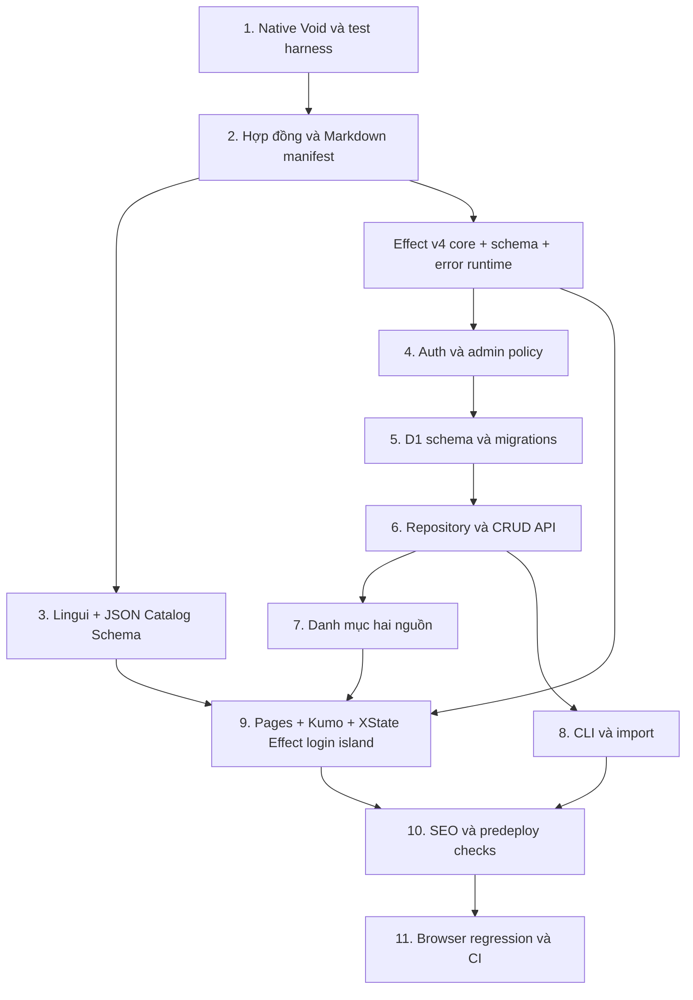

# Void content platform implementation plan

> **For agentic workers:** thực thi inline theo `finishing-execution`, từng task với checkpoint. Chỉ dùng `subagent-parallel-execution` khi người dùng yêu cầu dùng agent khác. Các bước dùng checkbox; không đánh dấu hoàn tất bằng suy đoán.

**Goal:** biến starter hiện tại thành website nội dung Việt/Anh/Trung, Markdown-first, có CRUD D1 qua API/CLI được bảo vệ, UI Kumo và SEO server-rendered.

**Architecture:** Void vẫn host Worker, Hono routes, Pages, Auth và Drizzle/D1. Effect v4 là functional core cho schema, use cases, service injection và errors; handler Void là runtime adapter. React Islands chỉ hydrate workflows tương tác; login dùng `@xstate/effect`, còn nội dung tĩnh không có actor. Markdown là Git-owned, D1 là runtime-owned.

**Tech stack:** Bun, Node, TypeScript, Void `1.1.12`, React `19`, Effect `4.0.5`, XState `6.0.0-alpha.70`, `@xstate/effect` `1.0.0-alpha.9`, `@xstate/react` `7.0.0-alpha.6`, `@void/md` `1.1.12`, Cloudflare Workers/D1, Kumo, Tailwind CSS `4`, Lingui, Bun test và Playwright.

**Status:** người dùng duyệt thực thi và yêu cầu dùng Effect v4 + XState Effect. Implementation đang tiến hành trên branch `feat/localized-content-platform`.

**Design:** [content-platform-design](../specs/2026-10-19-content-platform-design.md).

## Global constraints

- Làm trong Delta worktree đang được attach; đây đã là workspace cô lập. Không tạo checkout/worktree ngoài workspace.
- Trước task đầu, đọc `AGENTS.md`, các hướng dẫn lồng nhau nếu có, cùng `node_modules/void/docs/guide/quickstart.md` và `reference/cli.md`.
- Giữ `void`, `@void/react`, `@void/md` cùng phiên bản `1.1.12`; không thay Cloudflare Worker/Auth/Pages/route registry/Drizzle D1 bằng Effect Platform.
- Pin `effect@4.0.5`; không trộn Effect 3 package/API.
- Enable Worker `nodejs_compat` for the Node `crypto.timingSafeEqual` primitive; use Web Crypto for SHA-256 token digests.
- `@xstate/effect@1.0.0-alpha.9` + XState `6.0.0-alpha.70` + `@xstate/react@7.0.0-alpha.6` là alpha/experimental. Chỉ dùng trong login island; không chạy business API/runtime bằng alpha actor và không nâng framework để thỏa peer dependency.
- Node tối thiểu `22.19.0`; CI dùng Node `24`. Package registry đã được kiểm tra ngày 2026-10-19: Kumo `2.14.0`, Lingui `6.10.0`; chốt chúng trong lockfile, không dùng `latest` ở CI.
- Registry `peerDependenciesMeta` xác nhận Zod/ECharts là optional với Kumo `2.14.0`; dùng `Effect.Schema` thay Zod. Không cài ECharts. Kumo peer bắt buộc: React, React DOM và Phosphor icons `^2.1.10`.
- Locale duy nhất: `vi`, `en`, `zh-CN`; `vi` mặc định. Chữ Trung giản thể; không tự động dịch nội dung hoặc nhận `cn` thành locale mới.
- URL Markdown: `/{locale}/library/{slug}`. URL D1: `/{locale}/posts/{slug}`. `/` redirect `302` đến `/vi/`; home locale có trailing slash, detail/login không có. Noncanonical page URLs redirect `308`; không normalize đường API.
- Chỉ admin được CRUD. Admin web theo user ID server-side; CLI theo bearer token quản trị nội dung. Cấu hình thiếu nghĩa là từ chối.
- Không secret trong Git, CLI arguments, URL, stdout, browser props hoặc `VITE_*`. `.env` chỉ dùng local; production secret nhập qua Void CLI bởi operator.
- Không `db reset`, `db seed`, `db push`, remote mode, remote migration hay deploy trong thực thi tự động. Dùng migrations additive và `void db migrate` local.
- Bảng `posts` cũ và migration `20261019015751_vengeful_omega_red.sql` giữ nguyên; tạo `content_posts` riêng. Không tự chuyển dữ liệu cũ vì thiếu locale/slug/status.
- Endpoint demo `/api/posts` đổi sang hợp đồng mới được ghi rõ trong README. Xóa ví dụ TanStack và lời gọi demo không còn tương thích; không giả vờ giữ nguyên API cũ.
- Không full-table body scan cho danh mục, không N+1 để lấy bản dịch, không shared ISR cho danh mục/D1/auth trong đợt đầu.
- Không dashboard biên tập, upload media, full-text search, scheduling, tự dịch hoặc tự đồng bộ hai chiều.
- Plan và spec được cập nhật theo quyết định Effect/XState của người dùng. Checklist chỉ đánh dấu sau khi kiểm tra thực tế; lệnh bên dưới không phải bằng chứng đã chạy.
- Mỗi task commit riêng sau khi kiểm thử qua; chỉ stage các file của task, không `git add .`. Git commit dùng `GIT_EDITOR=true`. Không push/merge vào `main`.

## Bản đồ file và trách nhiệm

| File/nhóm file | Trách nhiệm |
| --- | --- |
| `vite.config.mts`, `tsconfig.json`, `package.json`, `bun.lock` | Plugin Void/React/Markdown/Tailwind, scripts và dependency |
| `src/content/contracts.ts` | Effect Schema, giới hạn payload, DTO và schema/error mapping |
| `src/core/errors.ts`, `src/core/run.ts` | Tagged errors và HTTP/CLI Effect boundary |
| `src/content/programs.ts` | Effect use cases thuần/injected |
| `src/content/repository.ts` | Effect `Context.Service` repository contract |
| `src/content/repository.server.ts` | Request-scoped Drizzle/D1 adapter bằng Void APIs |
| `src/content/markdown.ts`, `src/content/frontmatter.ts` | Pure validation/indexing metadata và safe frontmatter parser |
| `src/content/manifest.server.ts` | Bridge duy nhất từ `@void/md/pages` vào server |
| `src/content/pagination.ts` | Cursor và comparator chung cho hai nguồn |
| `src/content/catalog.server.ts` | Hợp nhất metadata, lookup translation links |
| `src/content/render.server.ts` | Render Markdown D1 an toàn, không compiler JSX |
| `auth.ts`, `src/auth/policy.ts`, `src/auth/social-providers.ts`, `src/auth/admin.server.ts` | Optional Void OAuth providers, Effect admin policy, typed provider availability |
| `src/auth/login-machine.ts` | XState Effect statechart và typed auth services |
| `src/components/LoginActor.tsx` | React island bridge, scoped runtime và actor disposal |
| `src/http/content-errors.server.ts` | Domain error → JSON/status; không lộ SQL/stack |
| `src/i18n/locales.ts`, `src/i18n/runtime.tsx` | Locale source of truth, request/island provider |
| `src/locales/{vi,en,zh-CN}/messages.json` | Catalog UI, không chứa toàn bộ bài viết |
| `lingui.config.ts`, `schemas/lingui-catalog.schema.json` | Extract/compile và JSON Schema |
| `middleware/01.page-context.ts` | Shared locale/chrome và Markdown head defaults |
| `pages/`, `src/components/` | SSR HTML và Kumo islands |
| `src/seo/head.ts`, `src/seo/sitemap.server.ts` | Pure head descriptor và sitemap data |
| `routes/api/`, `routes/sitemap.xml.ts`, `routes/robots.txt.ts` | Thin typed HTTP handlers |
| `scripts/content.ts`, `scripts/content-client.ts` | CLI parser và HTTP transport |
| `scripts/check-content.ts`, `scripts/check-catalogs.ts` | Build-time quality gates |
| `scripts/test-local.ts`, `tests/` | Disposable real-server/D1 tests, unit và browser |
| `docs/content-authoring.md`, `docs/operations.md` | Hướng dẫn viết bài, CLI và cấp quyền |

Các module `.server.ts` không được runtime-import vào browser component. Component chỉ import DTO bằng `import type`.

## Trình tự và phụ thuộc



Các nhánh thể hiện phụ thuộc kỹ thuật, không tự cấp phép delegate.

## Task 1 — Native Void Pages và test harness cô lập

**Files**
- Modify: `package.json:4-14`, `bun.lock`, `vite.config.mts:1-7`, `tsconfig.json:1-20`.
- Preserve untracked: `src/router.tsx`, `src/routes/index.tsx`, `src/routes/__root.tsx`; không sửa, xóa, stage hoặc đưa chúng vào PR. Typecheck/build exclude các file thử nghiệm này.
- Create: `pages/index.server.ts`, `pages/index.island.tsx`, `pages/layout.island.tsx`, `routes/api/health.ts`.
- Create: `scripts/test-local.ts`, `tests/local-context.ts`, `tests/integration/smoke.test.ts`.

**Interfaces**
- `GET /api/health → { ok: true }`, không DB, user hay secret.
- `scripts/test-local.ts <api|cli|e2e>` tạo project tạm dưới `.void/test-projects/`, khởi động Vite local, chạy suite và trả exit code của suite.
- Test subprocess nhận `TEST_BASE_URL`, `TEST_ADMIN_TOKEN`, `TEST_PROJECT_DIR`; không dùng biến đó để mở backdoor vào app.
- `tests/local-context.ts` export `baseURL: string`, `adminToken: string`; thiếu env thì fail với thông báo yêu cầu runner, không tự test production.

- [x] **1.1 — Viết smoke test trước:**

```ts
import { expect, test } from "bun:test";
import { baseURL } from "../local-context";

test("Void trả health JSON và trang chủ SSR", async () => {
  const health = await fetch(`${baseURL}/api/health`);
  expect(health.status).toBe(200);
  expect(await health.json()).toEqual({ ok: true });
  const page = await fetch(baseURL, { redirect: "manual" });
  expect([200, 302]).toContain(page.status);
});
```

- [x] **1.2 — Tạo runner:** copy allowlist source/config/migrations vào project tạm; symlink `node_modules`; không copy `.env`, `.void`, lock deployment identity hay local DB. `cwd` của Vite phải là project tạm. Chỉ forward env cần cho runtime/test, loại bỏ production credentials và `VOID_REMOTE`; không spread nguyên `process.env`. Chọn port loopback trống, dùng `--strictPort`; readiness có deadline 30 giây và chấp nhận HTTP response từ `/` kể cả 404, để test health mới là assertion RED. `finally` terminate process tree; giữ artifact lỗi trong `.void/test-projects/`, không xóa đường ngoài workspace.
- [x] **1.3 — Chạy RED:** request smoke test trên dev server thật nhận `404` ở `/api/health` trước khi thêm route. Nếu Vite chưa khởi động được, sửa harness/setup trước; startup error không thay thế bằng chứng regression.
- [x] **1.4 — Cài dependencies khi thực thi:** giữ các dependency đã có và khóa phiên bản trực tiếp của framework/Kumo/Lingui/Effect/XState.

```sh
bun add @void/md@1.1.12 react@19 react-dom@19
bun add --exact effect@4.0.5
bun add --exact xstate@6.0.0-alpha.70 @xstate/effect@1.0.0-alpha.9 @xstate/react@7.0.0-alpha.6
bun add @cloudflare/kumo@2.14.0 @phosphor-icons/react@^2.1.10
bun add @lingui/core@6.10.0 @lingui/react@6.10.0
bun add markdown-it gray-matter yaml@2
bun add -d typescript @types/react@19 @types/react-dom@19 @types/bun @types/markdown-it
bun add -d tailwindcss@4 @tailwindcss/vite@4
bun add -d @lingui/cli@6.10.0 @lingui/format-json@6.10.0
bun add -d ajv @playwright/test
```

Pin cả ba XState packages theo peer range của registry; không dùng `@alpha`, `next`, `workspace:*` hoặc tag chuyển động trong package/lockfile. Kiểm tra peer metadata trước khi cài. Không dùng `--force` để che mismatch. Lingui CLI dùng extractor mặc định, không experimental bundler; kiểm tra optional peer metadata của CLI trước khi thêm esbuild/rolldown trực tiếp.

- [x] **1.5 — Thay Vite config bằng chuỗi plugin:**

```ts
import { defineConfig } from "vite";
import { voidPlugin } from "void";
import { voidReact } from "@void/react/plugin";
import { voidMarkdown } from "@void/md/plugin";
import tailwindcss from "@tailwindcss/vite";

export default defineConfig({
  plugins: [voidPlugin(), voidReact(), voidMarkdown(), tailwindcss()],
});
```

Đổi TS `module` sang `ESNext`, `moduleResolution` sang `Bundler`; include `pages`, `routes`, `middleware`, `db`, `src`, `scripts`, `tests` và root config. Giữ strict/noEmit, thêm Bun test types. TS `exclude` explicit `src/router.tsx` và `src/routes/**` để giữ file chưa track của user khỏi typecheck; không xóa, sửa, copy hoặc stage chúng. **Không** ignore cả `src/routes` trong `.gitignore` vì routes native khác nằm ngoài đó. `typecheck` chạy `void prepare && tsc --noEmit`.

- [x] **1.6 — GREEN:** `bun run test:api` PASS (1 integration test/3 assertions), `bun run typecheck` PASS, `bun run build` PASS. `void prepare` chạy trong `typecheck`; server local dùng D1 scratch mới và áp dụng migration cũ ở scratch.
- [x] **1.7 — Commit:** `e3a5bfe refactor: adopt native Void Pages`.

## Task 2 — Hợp đồng nội dung và Markdown quality gate

**Files**
- Create: `src/i18n/locales.ts`, `src/content/contracts.ts`, `src/content/markdown.ts`, `src/content/frontmatter.ts`, `src/content/manifest.server.ts`, `src/core/errors.ts`.
- Create: `scripts/check-content.ts`, `tests/fixtures/content.ts`, `tests/unit/content-contracts.test.ts`, `tests/unit/markdown.test.ts`.
- Create bài mẫu public: `pages/vi/library/khoi-nguon.md`, `pages/en/library/origins.md`, `pages/zh-CN/library/qi-yuan.md`.
- Modify: `package.json` để thêm `content:check`.

**Interfaces**

```ts
import { Schema } from "effect";

export const locales = ["vi", "en", "zh-CN"] as const;
export type Locale = (typeof locales)[number];
export type ContentKind = "article" | "news" | "event";
export type ContentStatus = "draft" | "published";
export type ContentSource = "markdown" | "d1";

export const contentInputSchema = Schema.Struct({
  translationKey: Schema.String,
  locale: Schema.Literals(locales),
  slug: Schema.String,
  kind: Schema.Literals(["article", "news", "event"]),
  title: Schema.String,
  description: Schema.String,
  body: Schema.String,
  status: Schema.Literals(["draft", "published"]),
  publishedAt: Schema.NullOr(Schema.String),
  startsAt: Schema.NullOr(Schema.String),
  endsAt: Schema.NullOr(Schema.String),
  location: Schema.NullOr(Schema.String),
});
export type ContentInput = Schema.Schema.Type<typeof contentInputSchema>;
export interface ContentRecord extends ContentInput {
  id: string;
  version: number;
  createdAt: string;
  updatedAt: string;
}
export interface ContentSummary {
  key: string; // "markdown:<path>" hoặc "d1:<id>"
  source: ContentSource;
  translationKey: string;
  locale: Locale;
  slug: string;
  kind: ContentKind;
  title: string;
  description: string;
  publishedAt: string;
  startsAt: string | null;
  endsAt: string | null;
  location: string | null;
  url: string;
}

```

`contracts.ts` dùng `effect/Schema` làm SoT runtime + static TypeScript contract. Export `contentMetadataSchema` (không body), `contentInputSchema` (metadata + body), `updateContentSchema` (full replacement input + positive integer version), `contentQuerySchema`; TypeScript types suy ra từ schemas, không khai báo song song interface input. Dùng `Schema.toStandardSchemaV1` cho Void validator. `src/core/errors.ts` export `ContentError extends Data.TaggedError`, nhận status `400|401|403|404|409|413|422|500` và code; không phụ thuộc Hono. Dùng cùng field definitions và invariant validators, không nhân đôi luật ngày/event giữa schemas.

- [x] **2.1 — Viết fixture dùng xuyên task:**

```ts
import type { ContentInput } from "../../src/content/contracts";
export const publishedPost: ContentInput = {
  translationKey: "api-fixture",
  locale: "vi",
  slug: "khoi-nguon",
  kind: "article",
  title: "Khởi nguồn",
  description: "Bài viết mẫu cho nền tảng nội dung.",
  body: "# Khởi nguồn\n\nĐi về cội nguồn.",
  status: "published",
  publishedAt: "2026-10-19T00:00:00.000Z",
  startsAt: null,
  endsAt: null,
  location: null,
};
```

- [x] **2.2 — RED test:**

```ts
import { expect, test } from "bun:test";
import { Schema } from "effect";
import { contentInputSchema } from "../../src/content/contracts";
import { publishedPost } from "../fixtures/content";

test("từ chối locale, URL slug và published metadata không hợp lệ", () => {
  const decode = Schema.decodeUnknownSync(contentInputSchema);
  for (const patch of [
    { locale: "cn" }, { slug: "../secret" },
    { status: "published", publishedAt: null }, { title: "" },
  ]) {
    expect(() => decode({ ...publishedPost, ...patch })).toThrow();
  }
  expect(decode(publishedPost)).toEqual(publishedPost);
});
```

Chạy `bun test tests/unit/content-contracts.test.ts tests/unit/markdown.test.ts`; mong đợi module/schema chưa có hoặc các invalid cases chưa bị từ chối.

- [x] **2.3 — Implement Effect Schema strict schemas:** locale enum; slug ASCII kebab-case tối đa 160; title 1–200; description 1–500; translationKey 1–160, chỉ chữ số/chữ ASCII/dấu `-_.`; body tối đa 200 KiB UTF-8; request cap 256 KiB; version integer dương. Ngày parse/normalize về ISO UTC; publishedAt bắt buộc khi published và không ở tương lai vì chưa có scheduling. Event bắt buộc startsAt/location, endsAt nếu có không trước startsAt; non-event không nhận event fields khác null. Test bằng `Schema.decodeUnknownSync`; adapter HTTP dùng `Schema.toStandardSchemaV1`. Không cài Zod.
- [x] **2.4 — Implement `buildMarkdownIndex(pages)` thuần:** nhận metadata shape của `@void/md/pages`, validate bằng `contentMetadataSchema` vì virtual manifest không có body; optional event/published fields thiếu trong frontmatter được normalize về `null` trước decode; kiểm tra locale/slug/title từ path trùng frontmatter; published-only, translationKey unique theo locale, group kind nhất quán. Bài trong `pages/` có status khác published làm build fail. `manifest.server.ts` là nơi import virtual module, không import nó vào unit tests hoặc CLI Bun.
- [x] **2.5 — `check-content.ts`:** kiểm tra file thực dưới ba thư mục library bằng `parseMarkdownContent(source)` từ `src/content/frontmatter.ts`; gọi `stat` và từ chối file >256 KiB trước khi đọc nội dung. Dùng `gray-matter` với YAML 1.2 engine override qua `yaml@2`, unique keys, custom tags tắt, alias expansion tối đa 20; chỉ chấp nhận schema metadata đã validate. Không tự viết parser frontmatter regex hoặc nhận YAML tag JavaScript. Tạo bài mẫu ba ngôn ngữ với cùng translationKey `origins`, khác nhóm `api-fixture` của D1 tests.
- [x] **2.6 — GREEN:** `bun test tests/unit/content-contracts.test.ts tests/unit/markdown.test.ts tests/unit/markdown-index.test.ts` PASS (8 tests, 22 assertions; UTF-8 body limit); `bun run content:check` PASS (3 bài); `bun run typecheck` PASS; `bun run build` PASS với `@void/md/pages` manifest; `bun run test:api` PASS (3 tests, 11 assertions).
- [x] **2.7 — Commit:** `c2239a6 feat: add Effect schemas and localized content contracts`.

## Task 3 — Lingui JSON và locale isolation

**Files**
- Create: `lingui.config.ts`, `schemas/lingui-catalog.schema.json`, `scripts/check-catalogs.ts`.
- Create: `src/i18n/messages.ts`, `src/i18n/runtime.tsx`, `src/locales/vi/messages.json`, `src/locales/en/messages.json`, `src/locales/zh-CN/messages.json`.
- Create: `tests/unit/i18n.test.ts`, `tests/unit/catalog-schema.test.ts`.
- Modify: `package.json`, `.gitignore` để ignore compiled `src/locales/*/messages.ts`.

**Interfaces**
- `loadMessages(locale: Locale): Promise<Messages>` chỉ import compiled catalog của locale đó; `loadI18n(locale: Locale): Promise<I18n>` tạo instance mới bằng `setupI18n`.
- `LocaleProvider({locale, messages, children})` là component đồng bộ, tạo instance riêng ổn định bằng `useMemo`; SSR loader/middleware await `loadMessages` trước render. Island nhận **compiled catalog của locale hiện tại** qua serializable props, không trở thành async React client component.
- `src/i18n/messages.ts` dùng message descriptors có annotation `/* i18n */` để extractor nhận diện; không yêu cầu Babel macro plugin.
- Các ID đầu tiên: `nav.home`, `nav.library`, `auth.signIn`, `auth.signUp`, `auth.email`, `auth.password`, `auth.name`, `auth.error`, `auth.signOut`, `content.empty`, `content.next`, `language.unavailable`.

- [x] **3.1 — RED test cho isolation:** test được viết trước `runtime.tsx`; Ban đầu import thất bại vì module chưa có.

```ts
import { expect, test } from "bun:test";
import { loadI18n } from "../../src/i18n/runtime";

test("instance SSR không rò locale giữa request", async () => {
  const [vi, en, zh] = await Promise.all([
    loadI18n("vi"), loadI18n("en"), loadI18n("zh-CN"),
  ]);
  expect(vi._("auth.signIn")).toBe("Đăng nhập");
  expect(en._("auth.signIn")).toBe("Sign in");
  expect(zh._("auth.signIn")).toBe("登录");
  expect(vi).not.toBe(en);
  expect(vi._("auth.signIn")).toBe("Đăng nhập");
});
```

- [x] **3.2 — Config dùng JSON formatter chính thức:**

```ts
import { defineConfig } from "@lingui/cli";
import { formatter } from "@lingui/format-json";
import { locales } from "./src/i18n/locales";

export default defineConfig({
  locales: [...locales],
  sourceLocale: "vi",
  catalogs: [{ path: "src/locales/{locale}/messages", include: ["src", "pages"] }],
  format: formatter({ style: "lingui", origins: true, lineNumbers: false }),
});
```

Compiled module được import bằng map tĩnh ba dynamic import, không biến pathname tùy ý. Message descriptor mẫu dùng đúng pattern extractor hỗ trợ:

```ts
import type { MessageDescriptor } from "@lingui/core";
export const signIn: MessageDescriptor = /* i18n */ {
  id: "auth.signIn",
  message: "Đăng nhập",
  comment: "Nhãn nút gửi form đăng nhập",
};
```

- [x] **3.3 — Schema JSON:** top-level object key là message ID; mỗi entry phải có `translation`, `message`, `placeholders`, `comments`, `origin`, optional `context` và `obsolete` đúng output đã sinh từ formatter `6.10.0`. `Ajv` strict mode reject unknown fields, sai types và shape origins; cross-catalog gate reject thiếu ID/bản dịch rỗng.
- [x] **3.4 — Scripts:** `i18n:extract = lingui extract`, `i18n:check = bun scripts/check-catalogs.ts && lingui check sync`, `i18n:compile = lingui compile --typescript --strict`. Map loader import ba compiled `messages.ts` modules; không khai báo wildcard module để che missing types. Không bật fallback locale. Build/typecheck compile catalogs trước khi dùng; unit i18n tests kiểm tra request isolation và serializability của catalogs.
- [x] **3.5 — GREEN:** `bun run i18n:extract` PASS (15 messages, target locales missing 0), `bun run i18n:check` PASS, `bun run test:unit` PASS (11 tests, 31 assertions), `bun run typecheck` PASS, `bun run build` PASS. Test sai catalog/ID/JSON Schema cho fail.
- [x] **3.6 — Commit:** `25de669 feat: add Lingui JSON catalogs`.

## Task 4 — Auth bốn provider và policy admin fail-closed

**Files**
- Modify: `void.config.ts:4-8`.
- Create: `env.ts`, `auth.ts`, `src/auth/policy.ts`, `src/auth/social-providers.ts`, `src/auth/admin.server.ts`, `routes/api/profile.ts`.
- Create: `tests/unit/admin-policy.test.ts`, `tests/unit/social-providers.test.ts`, `tests/integration/auth.test.ts`.
- Modify: `scripts/test-local.ts` để isolate auth/data state trong DB tạm.

**Interfaces**
- `AdminPolicy = { adminUserIds: readonly string[]; tokenSha256?: string }`.
- `authorizeContentAdmin(request, policy): Effect.Effect<AdminIdentity, ContentError>`; policy thuần, không truy cập Hono/env trực tiếp.
- `requireContentAdmin(c): Effect.Effect<AdminIdentity, ContentError>` lấy user bằng Void auth, credentials bằng `void/env`; không export bearer/token digest cho client.
- `GET /api/profile` yêu cầu session; chỉ trả `{id, name, isAdmin}`, không có token/session record.

- [x] **4.1 — RED test policy:** unit test được thêm trước `src/auth/policy.ts`; phát hiện unauthenticated cần 401 riêng với authenticated non-admin 403.

```ts
import { expect } from "bun:test";
import { Effect } from "effect";
import { authorizeContentAdmin } from "../../src/auth/policy";

const member = authorizeContentAdmin(
  { userId: "member", method: "GET" },
  { adminUserIds: [] },
);
const anonymous = authorizeContentAdmin(
  { method: "POST", authorization: undefined },
  { adminUserIds: [] },
);

await expect(Effect.runPromise(member))
  .rejects.toMatchObject({ _tag: "ContentError", status: 403 });
await expect(Effect.runPromise(anonymous))
  .rejects.toMatchObject({ _tag: "ContentError", status: 401 });
```

Chạy `bun test tests/unit/admin-policy.test.ts`; xác nhận 401/403 semantics trước khi tích hợp route handlers.

- [x] **4.2 — Config auth + env:** `void.config.ts` bật email/password. `auth.ts` thêm `github`, `google`, `twitter` nếu provider có đủ client ID/secret; thiếu/một nửa credentials không làm Worker hoặc email auth ngừng hoạt động. `src/auth/social-providers.ts` định nghĩa credential-key mapping và chọn provider đủ cả hai giá trị. Env server gồm `ADMIN_USER_IDS` (JSON array, default `[]`), `CONTENT_API_TOKEN_SHA256` (optional 64 lowercase hex), `SITE_URL` và sáu khóa OAuth. Social login production yêu cầu operator nhập OAuth credentials thật; không có default giả. UI chỉ enable provider có credentials.
- [x] **4.3 — Policy:** token CLI là random secret do operator cấp; server chỉ giữ SHA-256 digest. Hash candidate bằng Web Crypto; so sánh fixed-length digests bằng `timingSafeEqual` từ `node:crypto`; `void.config.ts` bật `nodejs_compat`. Reject malformed Authorization; bearer sai không fallback sang session.
- [x] **4.4 — Origin:** session mutations bắt buộc Origin đúng request origin; không tin `X-Forwarded-*`. Bearer là cơ chế riêng; không mở CORS wildcard/credential sharing. Void auth giữ protection/rate limit mặc định — [Void authentication, retrieved 2026-10-19](https://void.cloud/guide/auth).
- [x] **4.5 — Runner auth fixtures:** test runner sandbox đặt admin allowlist rỗng, không truyền OAuth/API production credentials và không cần fake OAuth. Integration test đăng ký email, nhận cookie, xác nhận `/api/profile` 401 trước đăng nhập rồi trả ID/name và `isAdmin:false` sau đăng nhập; không dùng production user hoặc email delivery.
- [x] **4.6 — GREEN:** `bun test tests/unit/admin-policy.test.ts tests/unit/social-providers.test.ts` PASS (4 tests, 11 assertions); `bun run test:api` PASS (email signup/profile + smoke, 4 tests / 16 assertions, without OAuth secrets); `bun run typecheck` PASS. OAuth live chưa kiểm chứng.
- [ ] **4.7 — Commit:** `GIT_EDITOR=true git commit -m "feat: restrict content administration to admins"`.

## Task 5 — D1 schema additive, constraints và query plans

**Files**
- Modify: `db/schema.ts:1-9` bằng cách thêm export, không sửa `posts`.
- Create: `db/schema/content-posts.ts`, `tests/unit/migrations.test.ts`, `tests/migration-fixture.ts`.
- Generated bằng Void: SQL mới trong `db/migrations/`, snapshot mới và entry append trong `db/migrations/meta/_journal.json`; dùng tên timestamp CLI sinh, không tự bịa tên trước.

**Interfaces**
- `db/schema/content-posts.ts` export Drizzle table `contentPosts`; `db/schema.ts` re-export nó, giữ export `posts` cũ.
- `applyProjectMigrations(db: Database, range: { through?: number; after?: number }): Promise<void>` là helper chỉ dùng trong tests, không export vào app runtime.

**Access patterns → representation**
- Public list theo locale/status/(kind)/publishedAt/id; point lookup locale+slug; translations theo translationKey/status.
- Storage tier D1 row store; hot select là metadata, cold/variable-length là body.
- Primary key `id` UUID; unique `(locale,slug)`, `(translationKey,locale)`. Indexes theo thiết kế, explicit names `content_locale_published`, `content_locale_kind_published`, `content_translations`.
- Invariants: enums, published timestamp, event ordering, version > 0. CHECK/UNIQUE thực sự tồn tại trong SQL, không chỉ trong Zod.
- Lineage: immutable ID, source=`d1`, translationKey, version.

- [x] **5.1 — RED migration test:** dùng SQLite memory, apply SQL migrations theo journal, không dùng database development.

```ts
import { Database } from "bun:sqlite";
import { expect, test } from "bun:test";
import { applyProjectMigrations } from "../migration-fixture";

test("migration mới giữ bảng posts cũ", async () => {
  const db = new Database(":memory:");
  await applyProjectMigrations(db, { through: 0 });
  db.run("INSERT INTO posts (title, body) VALUES (?, ?)", ["keep", "unchanged"]);
  await applyProjectMigrations(db, { after: 0 });
  expect(db.query("SELECT title, body FROM posts").get())
    .toEqual({ title: "keep", body: "unchanged" });
  expect(db.query("SELECT name FROM sqlite_master WHERE name='content_posts'").get())
    .not.toBeNull();
  db.close();
});
```

Tạo `tests/migration-fixture.ts`: `applyProjectMigrations(db, range)` đọc journal ordered, chạy từng SQL với `db.exec`, hỗ trợ `through` inclusive/`after` exclusive. Không gọi Void remote CLI từ test. Trước thêm migration, assertion table mới phải FAIL.

- [x] **5.2 — Schema:** dùng `void/schema-d1`/`void/db` typed APIs; columns khớp `ContentRecord` (camelCase TS, snake_case SQL). `.notNull()` ở required fields; publishedAt và event fields nullable đúng contract. Generated SQL không được DROP/RENAME bảng `posts`.
- [x] **5.3 — Generate:** `bunx void db generate`; review SQL, snapshots/journal diff, auth tables được Void sinh sau Task 4. Không tự khai lại auth tables ở app schema.
- [x] **5.4 — Query plans:** test `EXPLAIN QUERY PLAN` cho public list có/không kind, point lookup và translations. Assert sử dụng index phù hợp, không `SCAN content_posts` toàn bảng và không temp sort cho hai public-list queries. Với cast/function trên ngày làm mất index, đổi query thay vì thêm cache che chi phí.
- [x] **5.5 — GREEN:** `bun test tests/unit/migrations.test.ts`, `bunx void db migrate` local, `bun scripts/test-local.ts api`. SQLite tests bổ sung duplicate/invalid locale/invalid event/version constraints. D1-runtime tests ở task sau vẫn bắt buộc vì SQLite không chứng minh toàn bộ D1 behavior.
- [ ] **5.6 — Commit:** `GIT_EDITOR=true git commit -m "feat: add localized content tables without altering legacy posts"`.

## Task 6 — Repository, safe rendering và CRUD API

**Files**
- Create: `src/content/repository.server.ts`, `src/content/render.server.ts`, `src/http/content-errors.server.ts`.
- Modify: `routes/api/posts.ts:1-8`.
- Create: `routes/api/posts/[id].ts`, `tests/integration/content-api.test.ts`, `tests/unit/render.test.ts`.

**Interfaces**
- `ContentRepository` là Effect v4 `Context.Service`, không phải Promise-returning static helper. Các methods trả `Effect.Effect<Result, ContentError>`.
- `ContentPrograms` export `createContent(input)`, `getPublished(locale,slug)`, `replaceContent(id,input,version)`, `removeContent(id,version)` dưới dạng Effect programs; errors được khai báo tường minh.
- `repository.server.ts` triển khai ContentRepository bằng `db`, operators và schema của `void/db`; mỗi request đưa program vào đúng D1-bound handler và inject request-scoped context/service. Không giữ DB binding/user/session trong module-global ManagedRuntime.
- Adapter là lớp duy nhất đổi rejected Drizzle Promise sang tagged `ContentError`; không bắt mất typed business errors trong use case.
- `renderContentMarkdown(body: string): string`; Markdown-it `html:false`, no arbitrary script/island/JSX compile for API input.
- `GET /api/posts?locale=vi&kind=article&limit=20&cursor=...` public published metadata; `view=admin` requires admin before query and returns metadata including status/version, never a free draft flag.
- `GET /api/posts/:id`: published record to public; draft only with authorized explicit admin view.
- `POST /api/posts` returns `201 {data: ContentRecord}`.
- `PUT /api/posts/:id` requires full input + version, returns `200 {data: ContentRecord}`.
- `DELETE /api/posts/:id` requires JSON `{version}`, returns `204`.
- Error envelope `{error:{code:string,message:string,fields?:Record<string,string>}}`; validation 422, malformed JSON/cursor 400, missing 404, uniqueness/version 409, oversized 413.

- [x] **6.1 — RED API test:**

```ts
import { expect, test } from "bun:test";
import { baseURL, adminToken } from "../local-context";
import { publishedPost } from "../fixtures/content";

test("CRUD từ chối unauth và cập nhật stale version", async () => {
  const url = `${baseURL}/api/posts`;
  const key = `api-${crypto.randomUUID()}`;
  const payload = { ...publishedPost, translationKey: key, slug: key };
  const anonymous = await fetch(url, {
    method: "POST", headers: { "Content-Type": "application/json" },
    body: JSON.stringify(payload),
  });
  expect(anonymous.status).toBe(401);
  const headers = {
    "Content-Type": "application/json",
    Authorization: `Bearer ${adminToken}`,
  };
  const created = await fetch(url, {
    method: "POST", headers, body: JSON.stringify(payload),
  });
  expect(created.status).toBe(201);
  const { data } = await created.json();
  const update = () => fetch(`${url}/${data.id}`, {
    method: "PUT", headers,
    body: JSON.stringify({ ...payload, title: "Updated", version: data.version }),
  });
  expect((await update()).status).toBe(200);
  expect((await update()).status).toBe(409);
});
```

- [x] **6.2 — Atomic write:** create dùng unique constraints làm authority; update `WHERE id=? AND version=?`, increment version trong cùng SQL, dùng `.returning()`. Không read-then-unconditional-write. Missing/stale được phân biệt sau conditional update; delete cũng version-checked. Repository thực hiện query Promise qua `Effect.tryPromise` và map SQL constraint errors thành tagged ContentError.
- [x] **6.3 — Routes:** handler là ranh giới duy nhất gọi `Effect.runPromise` trên Effect program; service/repository không gọi nó. Dùng `defineHandler` và `void/db` typed APIs, không cast `any`; cap stream bytes kể cả thiếu/sai Content-Length trước JSON parse. Authenticate mutations trước trả thông tin tài nguyên. Project metadata bằng select fields, không `.select()` toàn body cho list. Không xây `ManagedRuntime` global chứa binding có request scope.
- [x] **6.4 — Safe HTML test:**

```ts
import { expect, test } from "bun:test";
import { renderContentMarkdown } from "../../src/content/render.server";

test("D1 Markdown không thực thi raw HTML hoặc javascript URL", () => {
  const html = renderContentMarkdown(
    '<script>alert(1)</script>\n\n[bad](javascript:alert(1))\n\n',
  );
  expect(html).not.toContain("<script>");
  expect(html).not.toMatch(/href=["']javascript:/i);
});
```

Giữ URL validation mặc định an toàn của renderer; không thêm unsafe HTML plugin. Nếu cần images, không cho event handler/raw attribute từ Markdown.

- [x] **6.5 — GREEN:** `bun test tests/unit/render.test.ts`, `bun scripts/test-local.ts api`. Bổ sung duplicate creates song song, published→draft gỡ khỏi public ngay, 401/403, wrong token, missing/large JSON, deleted ID, cross-origin session và không lộ SQL/secret trong error.
- [ ] **6.6 — Commit:** `GIT_EDITOR=true git commit -m "feat: expose admin-only D1 content CRUD API"`.

## Task 7 — Danh mục hợp nhất và keyset pagination

**Files**
- Create: `src/content/pagination.ts`, `src/content/catalog.server.ts`, `tests/unit/pagination.test.ts`, `tests/integration/catalog.test.ts`.
- Modify: `src/content/repository.server.ts`, `src/content/markdown.ts`, `routes/api/posts.ts`.

**Interfaces**
- `Cursor = {v:1; locale:Locale; kind:ContentKind|null; publishedAt:string; key:string}`.
- `encodeCursor(cursor: Cursor): string`, `parseCursor(encoded, {locale,kind}): Cursor`; sai version/filter/length/encoding trả 400.
- `mergeSummaries(markdown: readonly ContentSummary[], d1: readonly ContentSummary[], limit: number): ContentSummary[]` nhận hai mảng đã được sort bằng cùng comparator; không sort lại toàn bộ dữ liệu mỗi request.
- `listCatalog({locale,kind?,limit,cursor?}): Promise<{items:ContentSummary[];nextCursor:string|null}>`.
- `listTranslations(translationKey, source): Promise<ContentSummary[]>` chỉ published, không query từng locale.
- Public API list dùng `listCatalog`; admin view là D1-only và ghi rõ source.

- [ ] **7.1 — RED test tie dates với hai nguồn:** viết unit test gọi `mergeSummaries(markdown,d1,limit)` trên hai mảng đã sort; khẳng định đúng page boundary khi input ingestion order khác nhau trước bước build-index. Key lexical là tie-break chung, publishedAt giảm dần. Fixtures tối thiểu 5 items cùng ngày, hai locales và hai kinds.

```ts
import { expect, test } from "bun:test";
import { encodeCursor, parseCursor } from "../../src/content/pagination";

test("cursor không được tái sử dụng sang locale khác", () => {
  const encoded = encodeCursor({
    v: 1, locale: "vi", kind: null,
    publishedAt: "2026-10-19T00:00:00.000Z", key: "d1:123",
  });
  expect(() => parseCursor(encoded, { locale: "en", kind: null }))
    .toThrow();
});
```

- [ ] **7.2 — Implement:** partition manifest theo locale/kind một lần; binary search cursor, lấy K+1 metadata. D1 lấy K+1 bằng indexed keyset; không trộn comparator SQLite collation với JavaScript `localeCompare`. Dùng byte/ASCII ordering của key, timestamp normalized.
- [ ] **7.3 — Complexity:** algorithm index seek + bounded merge `O(log N + log M + K)`; lineage key gồm source+ID/path. Khi cursor key nằm ở nguồn khác, D1 date/id predicate phải vẫn đúng tie ordering. Không lấy K bài mỗi nguồn rồi bỏ nextCursor trước khi xác định item cuối thực sự emit.
- [ ] **7.4 — GREEN:** `bun test tests/unit/pagination.test.ts`, `bun scripts/test-local.ts api`. API test duyệt hết các page của dữ liệu cố định, khẳng định không lặp/mất bài, filter locale/kind và body không xuất hiện trong list. Ghi rõ keyset không phải snapshot bất biến khi nội dung bị sửa giữa các request.
- [ ] **7.5 — Commit:** `GIT_EDITOR=true git commit -m "feat: merge Markdown and D1 content with bounded pagination"`.

## Task 8 — CLI CRUD, import và transport an toàn

**Files**
- Create: `scripts/content.ts`, `scripts/content-client.ts`, `tests/unit/content-cli.test.ts`, `tests/cli/content.test.ts`.
- Modify: `package.json` thêm `"content": "bun scripts/content.ts"`.

**Interfaces**
- `runContentCLI(argv: string[], io: {stdout:(text:string)=>void;stderr:(text:string)=>void}, env: Record<string,string|undefined>): Promise<number>`.
- `createContentClient({baseURL,token})` gọi typed API contract, `redirect:"error"`, không forward token qua redirect.
- Commands: `list --locale vi [--kind article] [--admin] [--cursor value]`, `get ID [--admin]`, `create --file PATH`, `update ID --file PATH --version N`, `delete ID --version N --yes`, `import PATH`, `check [--api]`.
- Env CLI: `CONTENT_API_URL`, `CONTENT_API_TOKEN`; HTTPS bắt buộc ngoài loopback. Không có `--token`; URL không được có username/password.
- Exit codes: 0 success; 1 network/API/domain failure; 2 invalid CLI arguments/config. stdout chỉ JSON, errors/progress vào stderr được redaction.

- [ ] **8.1 — RED test không xóa nếu thiếu xác nhận:**

```ts
import { expect, test } from "bun:test";
import { runContentCLI } from "../../scripts/content";

test("delete không có --yes không được gửi request", async () => {
  const output: string[] = [];
  const code = await runContentCLI(
    ["delete", "123", "--version", "1"],
    { stdout: (s) => output.push(s), stderr: (s) => output.push(s) },
    { CONTENT_API_URL: "http://127.0.0.1:5173" },
  );
  expect(code).toBe(2);
  expect(output.join("")).toContain("--yes");
});
```

- [ ] **8.2 — Parser:** dùng `node:util.parseArgs`, `Effect.Schema` và shared content contracts; không tự thêm framework CLI. Command logic trả Effect, main là boundary duy nhất dùng `Effect.runPromise`. Import module không tự chạy process; entry chỉ chạy khi `import.meta.main`. Validate args trước token/network.
- [ ] **8.3 — Import:** đọc frontmatter/body qua cùng parser Task 2, reject file trong cây `pages/*/library/` của repo, gọi POST, không delete/write file; duplicate translationKey+locale trả 409. Không compile script/component từ file import; body lưu dạng plain Markdown renderer an toàn.
- [ ] **8.4 — Transport:** timeout 15 giây, không tự retry mutation để tránh duplicate; parse non-JSON errors thành thông báo gọn, không in request headers. `delete --yes` là non-interactive rõ ràng, không prompt PTY làm treo.
- [ ] **8.5 — GREEN:** `bun test tests/unit/content-cli.test.ts`, `bun scripts/test-local.ts cli`. Suite dùng `Bun.spawn` gọi CLI thật, API/D1 thật: create→get→update→list→delete, import hai lần, wrong token, stale version, malformed input, redirect sang server capture khác; server thứ hai không được nhận Authorization.
- [ ] **8.6 — Commit:** `GIT_EDITOR=true git commit -m "feat: add authenticated content CLI and Markdown import"`.

## Task 9 — Trang đa ngôn ngữ và Kumo islands

**Files**
- Create: `middleware/01.page-context.ts`, `src/components/SiteChrome.tsx`, `src/components/ContentList.tsx`, `src/components/LanguageLinks.tsx`, `src/components/LoginIsland.tsx`, `src/styles/app.css`.
- Create: `src/auth/login-machine.ts`, `src/components/LoginActor.tsx`, `tests/unit/login-machine.test.ts`.
- Modify: `pages/layout.island.tsx`, `pages/index.server.ts`, `pages/index.island.tsx`.
- Create: `pages/[locale]/index.island.tsx`, `pages/[locale]/index.server.ts`, `pages/[locale]/posts/[slug].island.tsx`, `pages/[locale]/posts/[slug].server.ts`, `pages/[locale]/login.island.tsx`, `pages/[locale]/login.server.ts`.
- Create: `tests/integration/pages.test.ts`, `tests/e2e/auth.spec.ts`, `tests/e2e/content.spec.ts`.

**Interfaces**
- Middleware shared data: `{locale:Locale|null, path:string, messages:Messages|null, availableProviders:("github"|"twitter"|"google")[]}`; `messages` chỉ là compiled catalog locale hiện tại. Không embed session record/token vào mọi trang.
- Page props dùng `InferProps<typeof loader>`, không duplicate handwritten return type.
- `LoginIsland({locale, messages, availableProviders})` có Lingui provider riêng; dùng `auth` từ `void/client`.
- `LoginMachine`: XState v6 alpha `setupEffect`, Effect Schema events/context, login actor có Effect runtime và request-local auth service; observable UI state là typed idle/submitting/authenticated/failed.
- Login island dùng `@xstate/react` `useSelector` để đọc `EffectActor`; factory/runtime thuộc island instance và được dispose khi unmount. Không dùng `useMachine`/`useActor` để khởi chạy Effect-backed logic. Không lưu password vào actor snapshot/persistence/log.
- `LoginAuth` là Effect `Context.Service`: `signIn(input): Effect.Effect<void, LoginFailure>`. Adapter client gọi `auth.signIn.email`, map mọi lỗi thành thông báo chung, bỏ response/session data bằng `Effect.asVoid`; machine chỉ quan sát success/failure.
- `LoginActorRuntime` tạo trong `useEffect` ở browser. Không khởi tạo runtime/actor trong SSR render; cleanup dispose runtime và ngắt Effect đang chạy khi island rời trang.
- Markdown layout dùng shared locale trong SSR; interactive islands luôn nhận locale tường minh.

- [ ] **9.1 — RED request tests:** ba home URLs trả localized HTML, `/cn/` 404, missing D1 translation 404, `/` 302 đúng location, unpublished slug 404, unknown slug 404. Test SSR không phụ thuộc JavaScript. Unit tests login machine assert `SUBMIT` từ idle gọi service đúng một lần; success → authenticated; failure → failed không lộ detail exception; unmount/dispose interrupt actor, không chạy sign-in sau khi bị dispose.
- [ ] **9.2 — Unit test actor với services test-only:** `Effect.scoped(createEffectActor(loginMachine))`, inject `LoginAuth` mock bằng `Effect.provideService`; send events và chờ state bằng `waitFor`. Không mock `createEffectActor`/machine internals. Thử leak bằng snapshot sau success: password sent in `SUBMIT` event không tồn tại trong context/persisted snapshot, output chỉ `void`; TestClock dùng cho deadline nếu flow đặt timeout, không `sleep` thời gian thật.
- [ ] **9.3 — Styling entry ở `src/styles/app.css`:**

```css
@import "@cloudflare/kumo/styles/tailwind";
@import "tailwindcss";
@import "@void/md/theme-content.css";
@source "../../node_modules/@cloudflare/kumo/dist/**/*.{js,jsx,ts,tsx}";

body { font-size: 14px; }
.void-md { --vmd-line-height: 1.75; }
.void-md :where(code):not(pre code) { font-size: 0.9em; }
```

Import CSS từ root layout để cả Markdown lẫn TSX nhận stylesheet. Override Markdown headings/body bằng semantic Kumo tokens khi theme mặc định không khớp; không thêm một reset thứ hai.

- [ ] **9.4 — Island boundary:**

```tsx
import LoginIsland from "../../src/components/LoginIsland"
  with { island: "load" };
import type { Props } from "./login.server";

export default function LoginPage(props: Props) {
  return <LoginIsland
    locale={props.locale}
    messages={props.messages}
    availableProviders={props.availableProviders}
  />;
}
```

Dùng import path thực tế từ `pages/[locale]/login.island.tsx`; static layout chỉ `<a>`, không Void `Link`/router hooks. Kumo dùng granular imports cho Button/Input/Field components có sẵn ở phiên bản đã pin.

- [ ] **9.5 — Auth UI:** email sign-up/sign-in và sign-out, pending/error state từ actor, label/autocomplete phù hợp, ba social buttons gọi `auth.signIn.social({provider,callbackURL})`; callbackURL cùng origin, locale hợp lệ. Thiếu OAuth credentials thì disable có giải thích đã dịch, không fake response. Password chỉ component state + ephemeral `SUBMIT` event tới Effect logic; actor context/output/snapshot/logger không giữ password hoặc session token. Không xây forgot-password flow khi chưa cấu hình email delivery.
- [ ] **9.6 — Public UI:** danh mục với kind filter/pagination bằng links; D1 detail render sanitized HTML Task 6; Markdown giữ HTML/static layout. Language links tới published counterpart nếu có, nếu không tới home locale với nhãn “chưa có bản dịch”. Không tự dùng cùng slug cho ngôn ngữ khác.
- [ ] **9.7 — GREEN:** `bun test tests/unit/login-machine.test.ts`, `bun scripts/test-local.ts api`, `bun run typecheck`, `bun run build`. Tại browser task cuối, kiểm chứng form Kumo thực sự hydrate, actor được tạo sau mount và disposed sau unmount, không chỉ SSR screenshot. Typography 14px, headings semibold/sentence case, không tracking tùy ý/font-bold, không hover color transition; không thêm animation tùy chỉnh.
- [ ] **9.8 — Commit:** `GIT_EDITOR=true git commit -m "feat: build localized content pages with Kumo islands"`.

## Task 10 — Head, sitemap và kiểm tra xung đột trước deploy

**Files**
- Create: `src/seo/head.ts`, `src/seo/sitemap.server.ts`, `middleware/02.markdown-head.ts`.
- Modify: `void.config.ts`, `pages/[locale]/index.server.ts`, `pages/[locale]/posts/[slug].server.ts`, `pages/[locale]/login.server.ts`.
- Create: `public/favicon.svg`, `routes/sitemap.xml.ts`, `routes/sitemaps/[page].ts`, `routes/robots.txt.ts`, `routes/api/content-check.ts`.
- Modify: `env.ts`, `src/auth/admin.server.ts` để thêm credential read-only cho content-check.
- Modify: `scripts/check-content.ts`, `scripts/content.ts`.
- Create: `tests/unit/head.test.ts`, `tests/integration/seo.test.ts`, `tests/integration/content-check.test.ts`.

**Interfaces**
- `buildContentHead({entry,alternates,siteURL}): HeadDescriptor`; `entry: ContentSummary`, `alternates: ContentSummary[]`.
- `GET /api/content-check` admin-only, kiểm tra translationKey ownership D1 hiện tại với deployed Markdown manifest.
- `POST /api/content-check` admin-only, read-only đối với DB, nhận **candidate** Markdown metadata giới hạn/phân trang để kiểm tra trước deploy.
- Cả hai content-check endpoints cũng chấp nhận token read-only riêng: env `CONTENT_CHECK_TOKEN_SHA256`, dùng cùng digest verifier. Token này không được CRUD, không được xem body bản nháp; response chỉ trả conflict keys/counts.
- `content check --api` gửi manifest candidate từ local tree, không chỉ hỏi manifest cũ trên server. stdout JSON và nonzero khi conflict.

- [ ] **10.1 — RED head unit test:**

```ts
import { expect, test } from "bun:test";
import { buildContentHead } from "../../src/seo/head";
import type { ContentSummary } from "../../src/content/contracts";

test("canonical và alternate dùng đúng locale/nguồn", () => {
  const entry: ContentSummary = {
    key: "d1:1", source: "d1", translationKey: "origins",
    locale: "vi", slug: "khoi-nguon", kind: "article",
    title: "Khởi nguồn", description: "Giới thiệu",
    publishedAt: "2026-10-19T00:00:00.000Z",
    startsAt: null, endsAt: null, location: null,
    url: "/vi/posts/khoi-nguon",
  };
  const head = buildContentHead({
    entry, alternates: [entry], siteURL: "https://lanhdaovietnam.com",
  });
  expect(head.htmlAttrs?.lang).toBe("vi");
  expect(head.link?.filter((link) => link.rel === "canonical"))
    .toEqual([{ rel: "canonical", href: "https://lanhdaovietnam.com/vi/posts/khoi-nguon" }]);
});
```

- [ ] **10.2 — Global config:** title template `%s | Lãnh đạo Việt Nam`, lang fallback `vi`, charset/viewport/site name/favicon. Không global canonical, global og:url hay title template lặp brand. Dùng `defineHead` trong server companion cho D1/home/auth.
- [ ] **10.3 — Markdown:** middleware lookup manifest theo pathname, set headDefaults với lang/OG/Twitter/canonical/alternates/JSON-LD. Frontmatter title/description page thắng middleware; chỉ một canonical. Prerender Markdown chỉ được bật khi đã kiểm chứng head đi qua đúng middleware; nếu build prerender không bảo toàn head thì thêm companion server theo supported API, không chấp nhận SEO bị mất.
- [ ] **10.4 — Sitemap:** iterator keyset D1 published + Markdown manifest, escape XML. Giới hạn nội bộ bảo thủ 10.000 URL/part và 10 MiB/part; `/sitemap.xml` là index trỏ `/sitemaps/{page}`. Không build một array body của toàn bộ D1; không đưa draft/login/unsupported locales vào sitemap. Robots chỉ trỏ sitemap, không chứa admin token hay dùng robots để bảo vệ API. Chưa có social image thì bỏ `og:image`, không tạo SVG rồi giả định mọi social crawler đều hỗ trợ.
- [ ] **10.5 — JSON-LD:** `Article`/`NewsArticle`/`Event` đúng kind; không bịa author, address hoặc event attendance metadata. Serialize escape `<`, U+2028/U+2029 để không thoát script tag.
- [ ] **10.6 — Conflict check:** schema request và SQL lookup bounded bằng translation keys từng batch; phát hiện một nhóm bị xuất bản ở cả Markdown/D1. API create/update cũng kiểm tra manifest đang deploy. Không tự “chữa” bằng override/delete. Operator không chạy concurrent content writes khi deploy candidate manifest; ghi rõ preflight check không phải distributed lock.
- [ ] **10.7 — GREEN:** `bun test tests/unit/head.test.ts`, `bun scripts/test-local.ts api`, `bun run build`. Request HTML thực cho 3 Markdown + 3 D1 locales; parse head để assert một canonical, lang đúng, alternates reciprocal chỉ published, title/description/OG/Twitter, XML hợp lệ, login noindex.
- [ ] **10.8 — Commit:** `GIT_EDITOR=true git commit -m "feat: add localized SEO and candidate content preflight checks"`.

## Task 11 — Browser regression, CI và runbook

**Files**
- Create: `playwright.config.ts`, `tests/e2e/localization.spec.ts`, `tests/e2e/accessibility.spec.ts`.
- Extend: `scripts/test-local.ts`, `tests/e2e/auth.spec.ts`, `tests/e2e/content.spec.ts`.
- Create: `.github/workflows/ci.yml`, `docs/content-authoring.md`, `docs/operations.md`.
- Modify: `.github/workflows/void-deploy.yml:1-35`, `README.md:1-2`, `package.json`.

**Interfaces và scripts cuối**

```json
{
  "dev": "vite",
  "typecheck": "void prepare && tsc --noEmit",
  "test:unit": "bun test tests/unit",
  "test:api": "bun scripts/test-local.ts api",
  "test:cli": "bun scripts/test-local.ts cli",
  "test:e2e": "bun scripts/test-local.ts e2e",
  "content": "bun scripts/content.ts",
  "content:check": "bun scripts/check-content.ts",
  "i18n:extract": "lingui extract",
  "i18n:check": "bun scripts/check-catalogs.ts && lingui check sync",
  "i18n:compile": "lingui compile --typescript --strict",
  "build": "bun run content:check && bun run i18n:check && bun run i18n:compile && vite build",
  "check": "bun run i18n:check && bun run i18n:compile && bun run typecheck && bun run test:unit && bun run test:api && bun run test:cli && bun run build"
}
```

`test:e2e` riêng vì cần browser installation. CI phải chạy cả `check` lẫn `test:e2e`, không coi `check` một mình là toàn bộ gate.

- [ ] **11.1 — RED browser test chuyển locale:**

```ts
import { expect, test } from "@playwright/test";

test("người đọc đổi ngôn ngữ qua bản dịch có thật", async ({ page }) => {
  await page.goto("/vi/library/khoi-nguon");
  await expect(page.locator("html")).toHaveAttribute("lang", "vi");
  await page.getByRole("link", { name: "English", exact: true }).click();
  await expect(page).toHaveURL(/\/en\/library\/origins\/?$/);
  await expect(page.locator("html")).toHaveAttribute("lang", "en");
  await expect(page.getByRole("heading", { level: 1 })).toContainText("Origins");
});
```

- [ ] **11.2 — Browser matrix:** Chromium desktop và mobile viewport; signin/signup/signout email thật, member không được mutate, admin session mutate, login pending/error, mobile nav nếu có, language switch, locale/date formatting, missing translation, draft direct URL, next/back pages, Kumo focus/keyboard, reduced-motion. Capture screenshot lúc layout ổn định và console errors/hydration mismatch/network failures.
- [ ] **11.3 — Asset checks:** article không có island không tải app-wide hydration bundle; login chỉ tải island/catalog của locale hiện tại. Kiểm tra network/bundle manifest thay vì khẳng định “zero JS” tuyệt đối vì Markdown code-copy script có thể tồn tại.
- [ ] **11.4 — CI:** Node 24 + Bun, `bun install --frozen-lockfile`, `bun run check`, `bunx playwright install --with-deps chromium`, `bun run test:e2e`, upload test artifacts khi lỗi. Không cung cấp production OAuth/API token cho PR test.
- [ ] **11.5 — Deploy workflow:** thêm local gates trước bước deploy hiện có; candidate manifest preflight là bước riêng trước migration/deploy, dùng token read-only content-check được operator cấp. Deployment tự động sau bootstrap bắt buộc preflight; thiếu credential hoặc endpoint không truy cập được thì dừng, không skip im lặng. Lần đầu chưa có endpoint cần operator bootstrap theo runbook với phê duyệt riêng; không tự fallback từ preflight lỗi sang deploy. Không chạy workflow/deploy trong phiên triển khai này nếu chưa được phép.
- [ ] **11.6 — Runbook:** fresh install→prepare→migrate local→dev; viết Markdown/frontmatter; tạo từng locale; tạo draft/publish/update/delete qua CLI; cấp admin ID qua profile, tạo token ngoài source và lưu digest server, rotate/revoke, callback URLs OAuth từng môi trường. Không ghi token thật hoặc mặc định dùng production API trong ví dụ.
- [ ] **11.7 — Migration/rollback:** additive schema không drop legacy data; app rollback không tự restore DB hoặc xóa content mới. Nếu deployment migration hỏng, dừng deploy, review forward-fix; chỉ restore remote khi người dùng cho phép và hiểu dữ liệu ghi sau mốc sẽ mất.
- [ ] **11.8 — GREEN: final validation đúng command:**

```sh
bun install --frozen-lockfile
bun run check
bunx playwright install --with-deps chromium
bun run test:e2e
git diff --check
```

Mong đợi tất cả exit 0; báo số test thực tế, screenshots/artifacts và những check bị chặn. Social OAuth E2E chỉ đánh dấu PASS khi đã callback thật qua từng provider; thiếu credentials thì ghi NOT RUN, không đánh dấu xong bằng mock.

- [ ] **11.9 — Commit:** `GIT_EDITOR=true git commit -m "test: gate localized content workflows and document operations"`.

## Coverage matrix và điều kiện hoàn tất

| Yêu cầu | Tasks | Bằng chứng cần có |
| --- | --- | --- |
| Void folder conventions, không còn demo TanStack | 1, 9 | Typecheck/build, HTTP SSR |
| Markdown-first + Islands | 2, 9, 11 | Ba bài mẫu, page-source và network/hydration |
| D1 CRUD và CLI | 5, 6, 8 | Migration preservation, CLI/API/D1 thật |
| Admin-only, auth bốn provider | 4, 6, 9, 11 | Negative auth tests; email E2E; OAuth riêng khi có credentials |
| `vi`, `en`, `zh-CN`, Lingui JSON Schema | 2, 3, 9 | Catalog checks, ICU compile, concurrent SSR |
| Content/news/event và translation groups | 2, 5, 6, 7 | Schema/constraint tests, locale/kind filters |
| Public list không leak draft/body, không full scan | 5, 6, 7 | EXPLAIN, projection và pagination tests |
| SEO/head/canonical/hreflang/sitemap | 10 | HTML/XML response assertions, prerender checks |
| Kumo + Tailwind/design skill | 1, 9, 11 | Styled components thật, browser keyboard/mobile |
| Không phá data cũ/không vô tình deploy | 1, 5, 11 | Legacy-row test, scoped commands, runbook |

**Được coi là hoàn tất triển khai:** code coherent, các gate chạy thực tế, tài liệu đủ chạy local/CLI và mọi giới hạn OAuth/deploy được công bố. Viết xong plan không phải hoàn tất implementation.

## Self-review và nguồn tham chiếu

- Access patterns, storage tier, keys và algorithm trước repository; Task 5 kiểm tra indexes/constraints, Task 7 kiểm tra bounded merge. QC/lineage có trong Tasks 2/5/7/10.
- Không tạo backend abstraction, job queue, CMS hoặc state framework ngoài nhu cầu.
- Các interface/fixture ở trên là hợp đồng chung; task sau không tự đổi tên/type. Nếu package API khác ví dụ, đọc `.d.ts` của version đã pin rồi cập nhật plan/test trước, không cast qua lỗi.
- Package registry version/engine/peer metadata đã đọc ngày 2026-10-19; registry sources: `https://registry.npmjs.org/@cloudflare%2Fkumo/2.14.0`, `https://registry.npmjs.org/@lingui%2Fcli/6.10.0`, `https://registry.npmjs.org/@lingui%2Freact/6.10.0`.
- Lingui non-macro extraction dùng annotated descriptors — [Message extraction, retrieved 2026-10-19](https://lingui.dev/guides/message-extraction). Request-local instances dùng [setupI18n, retrieved 2026-10-19](https://lingui.dev/ref/core); React dùng [I18nProvider, retrieved 2026-10-19](https://lingui.dev/ref/react).
- Effect v4 LTS, platform scope and Standard Schema bridge — [Effect repository, retrieved 2026-10-19](https://github.com/Effect-TS/effect), [platform guide, retrieved 2026-10-19](https://effect.website/docs/v4/platform/introduction), [Schema adapter, retrieved 2026-10-19](https://effect.website/docs/v4/schema/standard-schema).
- `@xstate/effect` alpha requirements, actor lifecycle and React usage — [XState Effect repository, retrieved 2026-10-19](https://github.com/statelyai/xstate/tree/next/packages/xstate-effect).
- Void host boundaries — [Hono routing, retrieved 2026-10-19](https://void.cloud/guide/server-routing) and [Drizzle/D1, retrieved 2026-10-19](https://void.cloud/guide/database).
- Task 1 verified: `bun run test:api` PASS (one test, 3 assertions), `bun run typecheck` PASS, `bun run build` PASS. Remaining tasks are not yet verified; only Task 1 is checked complete.
