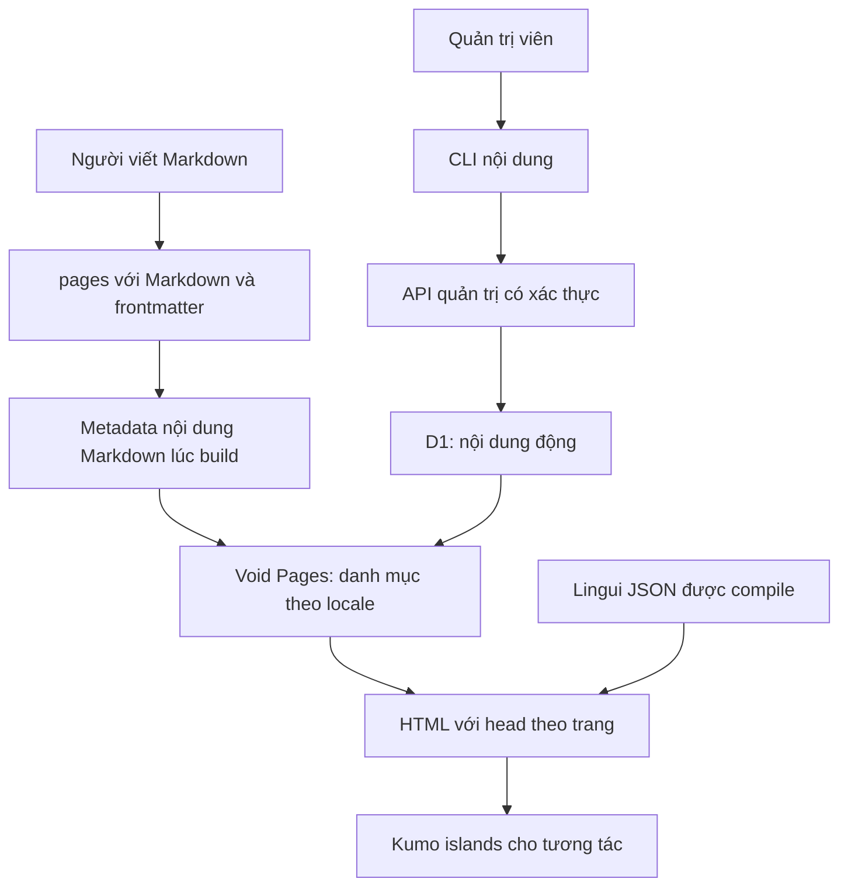

# Nền tảng nội dung Void: thiết kế đề xuất

Trạng thái: người dùng đã yêu cầu thực thi implementation plan. Code ứng dụng triển khai trên branch tính năng, không deploy production.

## Yêu cầu đã chốt và hướng triển khai đề xuất

- Dùng cấu trúc native Void, React Pages và Islands thay cho ví dụ TanStack Start hiện có.
- Effect v4 làm functional core cho use cases, content services, schema và typed errors; Void vẫn là HTTP, Pages, Cloudflare Worker, Auth và D1 host.
- Dùng `@xstate/effect` cho workflow tương tác trong islands; bài viết và layout tĩnh không cần actors.
- Markdown là cách viết mặc định; D1 hỗ trợ CRUD bài viết, tin tức và sự kiện qua API/CLI.
- Hỗ trợ `vi`, `en`, `zh-CN`; tiếng Việt mặc định. `zh-CN` dùng chữ giản thể theo đề xuất, không dùng `cn` làm mã locale.
- Email/password, GitHub, Twitter/X và Google đều được hỗ trợ.
- Chỉ quản trị viên được CRUD. Đăng nhập không đồng nghĩa với quyền quản trị.
- Dùng Kumo với Tailwind CSS v4 và hướng dẫn thiết kế Kumo.
- Lingui quản lý bản dịch UI bằng catalog JSON; nội dung dịch nằm trong Markdown/D1.
- Không tự động dịch, không tự động đồng bộ hai chiều Markdown và D1.

## Các phương án kiến trúc

1. **Native Void Pages + Islands — đề xuất:** dùng routing, auth, head và Markdown adapter của cùng framework; nội dung công khai ưu tiên HTML, tương tác hydrate theo nhu cầu.
2. **Giữ TanStack Start:** phù hợp ứng dụng tương tác lớn nhưng cần auth tích hợp riêng; không đạt mục tiêu dùng trực tiếp Void Pages/Islands và tăng số cơ chế phải bảo trì.
3. **Static site + backend riêng:** tách được biên tập và phân phối, nhưng thêm build/deploy và hợp đồng giữa hai ứng dụng chưa cần thiết.

## Kiến trúc và cấu trúc thư mục



```text
pages/
  layout.island.tsx
  [locale]/
    index.island.tsx
    index.server.ts
    posts/
      [slug].island.tsx
      [slug].server.ts
    login.island.tsx
  vi/library/                       # Markdown xuất bản
  en/library/
  zh-CN/library/
routes/api/
  posts.ts
  posts/[id].ts
  profile.ts                       # ID tài khoản hiện tại, không cấp quyền
src/
  components/
  content/                         # hợp đồng, metadata, resolver và validation
  i18n/
  locales/{locale}/messages.json
  styles/
scripts/
  content.ts
db/
  schema.ts
  migrations/
schemas/
  lingui-catalog.schema.json
env.ts
void.config.ts
vite.config.mts
```

Chỉ tạo thư mục thực sự cần dùng. Giữ migrations và schema hiện có; thay đổi dữ liệu phải qua migration có thể review, không reset database. Phần demo TanStack chưa hoàn chỉnh sẽ được thay thế rõ ràng, không khôi phục `src/demo.ts` đã bị người dùng xóa.

## Quyền sở hữu nội dung và URL

- Đề xuất hai namespace để tránh Markdown và D1 âm thầm che nhau: Markdown ở `/{locale}/library/{slug}`, D1 ở `/{locale}/posts/{slug}`.
- Trang chủ/danh mục hợp nhất metadata từ cả hai nguồn; người đọc không phải chọn nguồn để tìm bài.
- Hai nguồn dùng cùng hợp đồng metadata: `translationKey`, `locale`, `slug`, `kind`, `title`, `description`, ngày xuất bản; sự kiện thêm thời gian bắt đầu/kết thúc và địa điểm.
- `kind` nhận `article`, `news`, `event`. `translationKey` liên kết bản dịch, không đồng nhất slug giữa các ngôn ngữ.
- Mỗi nhóm bản dịch thuộc một nguồn. Không xuất bản cùng một nhóm ở cả hai nguồn. Kiểm tra metadata lúc build và API trước khi tạo/cập nhật.
- Import là thao tác rõ ràng từ file Markdown bên ngoài cây trang xuất bản sang D1. Không xóa file nguồn, không tự thay canonical hay tạo redirect. Chuyển bài đã công khai giữa hai nguồn chưa thuộc đợt đầu.
- Markdown đặt trong `pages/` phải là nội dung công khai. Nếu có `status: draft`, build phải từ chối; không chỉ ẩn bài khỏi danh mục rồi để URL vẫn truy cập được.

## Access patterns và representation

### Access patterns

| Đường đọc/ghi | Bộ lọc và thứ tự | Dữ liệu cần | Cách phục vụ |
| --- | --- | --- | --- |
| Danh mục công khai | locale, published, kind tùy chọn; ngày giảm dần, ID làm tie-break | Metadata, không lấy body | Index D1 và manifest Markdown được sắp sẵn |
| Chi tiết bài | locale + slug | Metadata + body của đúng bài published | Unique lookup D1 hoặc route Markdown |
| Liên kết bản dịch | translationKey + published | Locale, title, URL | Index nhóm dịch và manifest |
| Quản trị | ID, trạng thái, phân trang | Metadata; body khi đọc một bài | API yêu cầu quyền admin |
| Tạo/sửa/xóa | ID và version khi cập nhật | Payload được validate | D1 transaction/batch thích hợp; conflict trả 409 |
| Import | translationKey + locale | Một file Markdown có frontmatter | Gọi cùng API, không ghi trực tiếp D1 |

Không có số đo lưu lượng hoặc SLO production do người dùng cung cấp. Đợt đầu nhắm workflow biên tập, không phải ingestion hàng loạt. Kiểm thử bằng tập dữ liệu nhiều trang; không cam kết độ trễ khi chưa benchmark.

### Tier, keys và field layout

- Storage tier: Git/build manifest cho Markdown, D1/SQLite cho nội dung thay đổi tại runtime.
- D1 dùng một row cho mỗi bản dịch: ID bất biến, translationKey, locale, slug, kind, title, description, body Markdown, status, publishedAt, createdAt, updatedAt, version và thông tin sự kiện.
- Primary key: ID. Unique keys: `(locale, slug)` và `(translationKey, locale)`.
- Hot filter/select: locale, kind, status, publishedAt, ID, title và description. Body là trường variable-length/cold trên đường danh mục, chỉ đọc cho trang chi tiết và thao tác quản trị.
- Indexes: `(locale, status, publishedAt, id)`, `(locale, status, kind, publishedAt, id)` và `(translationKey, status)`.
- Không dùng một JSON blob làm nguồn sự thật cho các trường lọc. Ngày lưu nhất quán theo UTC; hiển thị qua `Intl` với locale tương ứng.
- Không partition vật lý ở quy mô khởi đầu; locale được phục vụ qua index.

### Algorithm, complexity và consistency

- Danh mục kết hợp hai tập metadata đã sắp thứ tự với cùng comparator; cursor bao gồm ngày và khóa có nguồn để không mất/trùng bài khi hai nguồn có cùng ngày.
- Algorithm: index seek và lấy tối đa K bản ghi D1, binary search cursor trong manifest Markdown đã sắp, rồi merge hai tập có giới hạn. Mục tiêu complexity là `O(log N + log M + K)` cho danh mục, với N/M là số bài D1/Markdown phù hợp bộ lọc, không phải quét toàn bộ mỗi request.
- Phân trang có giới hạn; không tải toàn bộ body hoặc toàn bộ bảng D1 để hợp nhất.
- Read-your-writes: D1 published content xuất hiện ở request tiếp theo. Đợt đầu không bật shared ISR cho nội dung D1, danh mục hợp nhất và trang auth.
- Updates dùng version/optimistic concurrency để không ghi đè thay đổi mới hơn; retry cùng khóa import trả conflict thay vì tạo bản trùng.

### Invariants, QC và lineage IDs

- Locale, kind, status và slug phải thuộc tập/định dạng hợp lệ; độ dài payload và body bị giới hạn.
- Published content phải có title, description, body và ngày xuất bản hợp lệ. Sự kiện có ngày kết thúc không trước ngày bắt đầu.
- Draft không xuất hiện trong public API, danh mục, sitemap, alternate links hoặc URL chi tiết công khai.
- Markdown/D1 được render an toàn: không thực thi script, không chấp nhận URL nguy hiểm hay HTML tùy ý từ API.
- Lineage IDs: source + ID/path, translationKey, locale và version. API/CLI trả lại ID/version và mã lỗi rõ ràng, không log token hay body riêng tư.
- Chặn trùng locale/slug trong từng nguồn và nhóm dịch giữa hai nguồn; build kiểm tra manifest, API kiểm tra nguồn đang được deploy và unique constraints D1.
- Khi một deployment đưa thêm Markdown xung đột với dữ liệu D1 có sẵn, lệnh kiểm tra trước deploy phải báo lỗi; việc chuyển nguồn không tự động ghi đè.

## Effect core, XState Effect và Void runtime

- Effect `4.0.5` là LTS. `@xstate/effect@1.0.0-alpha.9` hỗ trợ `effect ^4.0.0` nhưng yêu cầu XState `^6.0.0-alpha.70`; React integration hiện tương ứng là `@xstate/react@7.0.0-alpha.6`. Đây là prerelease/experimental.
- Không thay Void Worker/runtime. Effect Platform v4 công bố integrations cho Node/Deno, Bun và browser; không có Cloudflare Worker adapter trong danh sách. `Effect.runPromise` có thể thực thi chương trình bên trong một Void/Hono handler, nhưng thay entrypoint không tự giữ generated routing, Pages/Islands renderer, auth, D1 bindings, migrations hay Void deployment.
- Giữ `voidPlugin`, `voidReact`, `defineHandler`, `void/auth` và `void/db` làm adapters của platform. Luồng xử lý: `Void/Hono handler → Effect use case → Effect Repository service → Void Drizzle/D1`. `@effect/sql-d1@4.0.5` tồn tại nhưng không dùng ở đây vì sẽ tạo đường truy cập/schema/migration thứ hai bên cạnh Void/Drizzle.
- Effect service nhận request-specific auth/context/DB qua dependency injection; không lưu binding, actor, locale hay user vào mutable module-global runtime dùng chung giữa requests.
- Dùng `Effect.Schema` làm nguồn validation duy nhất. `Schema.toStandardSchemaV1` nối với `defineHandler.withValidator`, giữ typed request contract của Void. Không thêm Zod song song.
- `@xstate/effect` sử dụng `createEffectActor`, actor scope và React `useSelector`; **không** khởi chạy Effect-backed machine bằng `useMachine`/`createActor`. Actor của login island được tạo và hủy cùng island, không chia sẻ giữa users.
- Bắt đầu với login workflow: `idle → submitting → authenticated | failed`. Inject auth client như Effect service. Không lưu/ghi log password trong machine context/snapshot; không tự retry mutations. Test cancellation/unmount và event/state transitions.
- Giới hạn XState alpha trong island tương tác và pin chính xác các phiên bản trong lockfile. Không để alpha package làm runtime cho Content/SEO/auth server.

## Auth và authorization

- Bật bốn provider trong Void config; giữ cơ chế session, cookie, origin protection và migration auth của Void.
- Quản trị viên web được xác định bằng allowlist **user ID bất biến** ở cấu hình server, không dựa vào email người dùng tự khai hoặc một cờ client gửi lên.
- Allowlist rỗng nghĩa là không có quản trị viên. Endpoint profile chỉ cho người dùng xem ID của chính mình để operator cấp quyền bằng cấu hình server.
- CLI dùng bearer token có quyền quản trị nội dung, tách biệt với session và OAuth secrets. Token được operator cung cấp qua biến môi trường; không truyền bằng argument, lưu vào repo hoặc in log.
- Server thiếu token cấu hình thì tắt bearer access, không dùng giá trị mặc định. So sánh token bằng cách constant-time phù hợp runtime.
- API quản trị chấp nhận admin session hoặc token; từ chối 401 khi chưa xác thực và 403 khi có session nhưng không đủ quyền.
- Mutations bằng session kiểm tra same-origin; bearer credential chỉ được CLI gửi đến API origin được cấu hình và không tự forward khi redirect sang host khác.
- OAuth credentials khai báo ở `env.ts`, cung cấp local bằng `.env`, production bằng `void secret put`; không tự deploy hoặc tạo ứng dụng OAuth hộ người dùng.
- Kiểm thử thật OAuth và production deployment phụ thuộc credentials/quyền của operator; không thể suy ra đã hoạt động chỉ từ build thành công.

## CLI/API đợt đầu

- CLI hỗ trợ `list`, `get`, `create`, `update`, `delete`, `import`, `check`; output JSON cho scripting.
- CRUD tác động nội dung D1. Markdown vẫn sửa bằng Git, không cho API ghi vào filesystem của Worker.
- API collection/item dùng Void typed handlers, schema validation chung và lỗi có cấu trúc.
- Public list/get chỉ trả published content; truy vấn bản nháp là thao tác quản trị, không bật bằng query flag không được kiểm quyền.
- Delete phải yêu cầu xác nhận rõ qua CLI; không xóa dữ liệu cũ trong quá trình scaffold/migrate.
- `check` hỗ trợ kiểm tra offline metadata và kiểm tra có xác thực với D1 trước deploy. Không dùng remote mode ngầm vì nó có thể tác động dữ liệu thật.
- Chưa xây dashboard CRUD, upload media, workflow duyệt bài, scheduled publishing, tìm kiếm toàn văn hay lịch sử revision đầy đủ.

## i18n và SEO

- Lingui catalogs dùng JSON `style: "lingui"` với mô tả/ngữ cảnh. JSON Schema kiểm tra cấu trúc; Lingui compile kiểm tra cú pháp ICU và bản dịch.
- `vi`, `en`, `zh-CN` là danh sách locale dùng chung cho routing, API validation, CLI và catalogs. Không âm thầm nhận `cn` như locale thứ tư.
- Không dùng singleton locale có thể thay đổi giữa request trên Worker. SSR tạo i18n instance theo request; mỗi island được truyền locale và có provider riêng, vì React context không tự đi qua các island độc lập.
- Chỉ tải catalog cần cho locale hiện tại. Ngày, giờ và số dùng `Intl`, không nối chuỗi định dạng thủ công.
- `/` chuyển đến `/vi/`. Locale không hỗ trợ trả 404; không tự tạo nội dung dịch.
- Bài thiếu bản dịch không xuất hiện dưới URL locale khác. Bộ chuyển ngôn ngữ chỉ liên kết bản published thực sự tồn tại; các locale còn lại dẫn đến danh mục với nhãn rõ ràng.
- Config head chứa charset, viewport, title template, site identity và favicon. Trang hiện tại quyết định `html lang`, description, Open Graph, Twitter card và canonical.
- Canonical xuất hiện đúng một lần theo URL thật; không đặt một canonical dùng chung trong config vì Void nối các mảng link.
- `hreflang` chỉ liệt kê bản dịch published; sitemap chỉ chứa URL công khai, robots không thay thế authorization.
- Trang auth được `noindex`; lỗi/draft không có metadata giả như một bài đã xuất bản. JSON-LD chỉ được tạo từ dữ liệu đã validate và serialize an toàn.

## Kumo, Tailwind và Islands

- Cài Kumo cùng React, React DOM, icons peer dependency và Tailwind v4 Vite integration.
- CSS import Kumo tokens trước Tailwind; khai báo `@source` đúng vị trí để quét utility classes trong package.
- Dùng component Kumo thực sự trên login/forms và các bề mặt tương tác, không chỉ thêm dependency.
- Tuân thủ design skill: content 14px, heading sentence case/semibold, không tracking tùy ý hoặc font-bold, semantic color tokens và spacing/radii nhất quán.
- Nội dung bài và layout ưu tiên static HTML. Login và menu tương tác là island load; thành phần dưới fold chỉ hydrate khi cần. Không dùng Void Router hooks ở island.
- UI không thêm animation tùy chỉnh trong đợt đầu theo phương án được đưa sang lập kế hoạch; giữ tương tác mặc định của Kumo và hỗ trợ reduced-motion.
- Có keyboard/focus states, label cho form, trạng thái pending/error và layout responsive.
- Login button và error/loading states lấy từ `@xstate/effect` actor trong island; form input bí mật vẫn nằm trong component state/request và không đưa password vào persisted actor snapshot/log.

## Kế hoạch xác minh

1. Chạy Void prepare, TypeScript check và build từ clean install với lockfile.
2. Test catalog JSON Schema, compilation, locale routing và hai SSR request khác locale chạy xen kẽ.
3. Test quyền admin/session/token, malformed payload, draft leakage, duplicate keys, stale version và import.
4. Test metadata/canonical/hreflang trên Markdown, D1, ba locale và trường hợp thiếu bản dịch.
5. Test CRUD qua CLI thật gọi API local và D1 local, không chỉ mock repository.
6. Test trên browser desktop/mobile: đăng nhập email, lỗi form, chuyển ngôn ngữ, điều hướng, hydration Kumo islands, keyboard và console.
7. Không xác nhận social OAuth end-to-end hay deploy production khi chưa có credentials. Không push/merge/deploy trong phạm vi duyệt thiết kế.

## Tài liệu đã đối chiếu

Các nguồn dưới đây được đọc ngày 2026-10-19; Void cũng được đối chiếu với docs đi kèm package `1.1.12`.

- [Void structure — native directories và optional conventions; retrieved 2026-10-19](https://void.cloud/reference/structure).
- [Void islands — partial hydration, static layouts và navigation; retrieved 2026-10-19](https://void.cloud/guide/pages-routing/islands).
- [Void Markdown — adapter, frontmatter và metadata manifest; retrieved 2026-10-19](https://void.cloud/guide/pages-routing/markdown).
- [Void config/head — merge precedence và link concatenation; retrieved 2026-10-19](https://void.cloud/reference/config#head).
- [Void auth — native Cloudflare support, provider secrets và migrations; retrieved 2026-10-19](https://void.cloud/guide/auth).
- [Kumo installation — Tailwind source scanning và peer dependencies; retrieved 2026-10-19](https://kumo-ui.com/installation/).
- [Kumo design skill — typography, spacing và interactions; retrieved 2026-10-19](https://kumo-ui.com/skill).
- [Lingui catalogs — JSON formatter và compiled runtime catalogs; retrieved 2026-10-19](https://lingui.dev/ref/catalog-formats).
- [Lingui CLI — extraction, compilation và validation; retrieved 2026-10-19](https://lingui.dev/ref/cli).
- [Effect 4 LTS and package scope; retrieved 2026-10-19](https://github.com/Effect-TS/effect).
- [Effect Platform supported runtimes; retrieved 2026-10-19](https://effect.website/docs/v4/platform/introduction).
- [Effect Schema Standard Schema adapter; retrieved 2026-10-19](https://effect.website/docs/v4/schema/standard-schema).
- [XState Effect alpha package, peer versions, actor lifecycle, React integration; retrieved 2026-10-19](https://github.com/statelyai/xstate/tree/next/packages/xstate-effect).
- [Void server route/Hono contract; retrieved 2026-10-19](https://void.cloud/guide/server-routing).
- [Void Drizzle/D1 data and migration contract; retrieved 2026-10-19](https://void.cloud/guide/database).

## Phạm vi được đưa sang lập kế hoạch

- Native Void Pages/Islands giữ Cloudflare runtime; Effect v4 dùng cho business core; XState Effect alpha chỉ cho workflow UI cần thiết.
- Hai namespace `library`/`posts` để phân định nguồn, với danh mục thống nhất.
- Admin allowlist theo user ID và credential riêng cho CLI.
- `zh-CN` chữ giản thể, UI không thêm animation tùy chỉnh, Effect core, và XState Effect với các peer alpha đã nêu.
- Implementation plan nằm ở `docs/plans/2026-10-19-content-platform-implementation.md`; người dùng đã duyệt thực thi trên branch tính năng, không deploy production.
